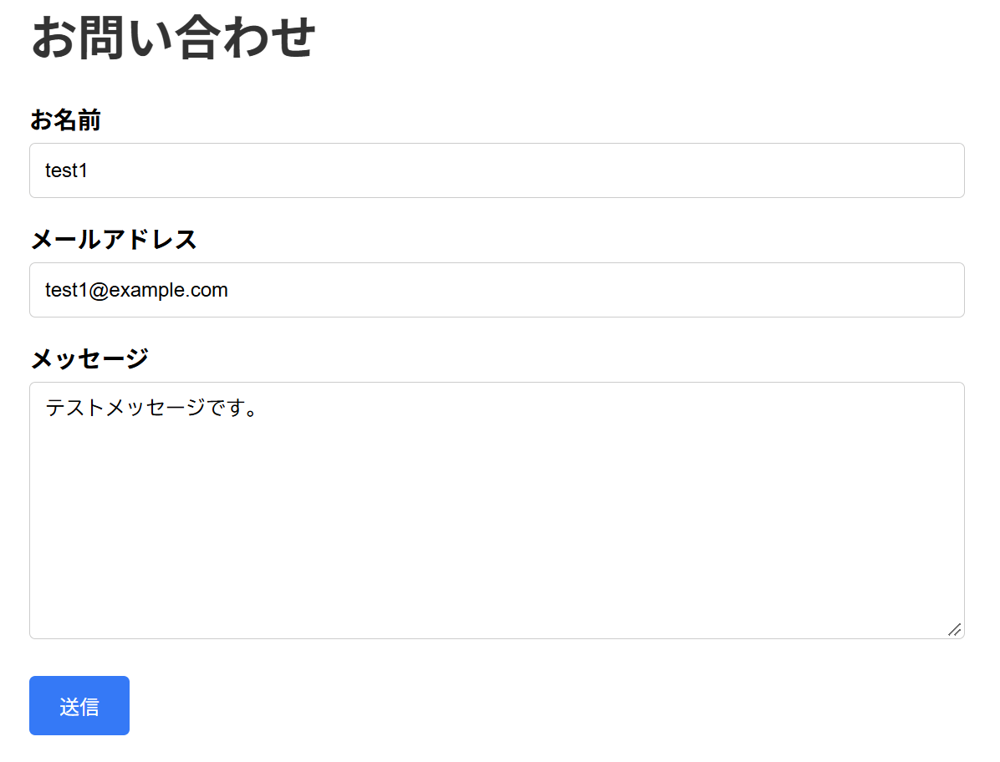
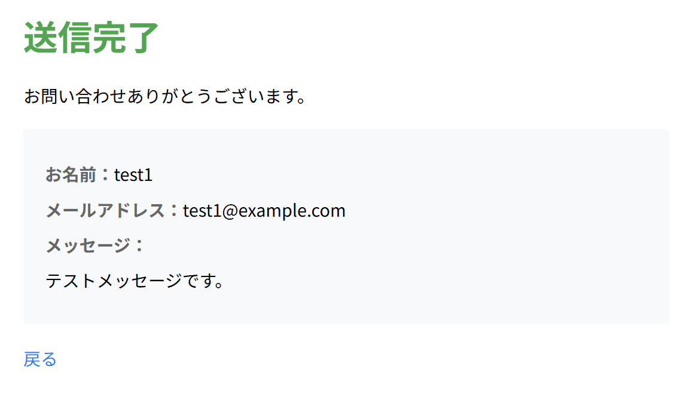

# security-app-practice

## 概要
COACHTECH 教材 Tutorial 10-6「Webセキュリティ ハンズオン」で作成した成果物です。
問い合わせフォームで入力された内容を遷移後の画面で表示する際に、csrf攻撃やXSS攻撃の対策がされているような実装を行った。

## 使用技術
- PHP 8.5.12
- Laravel 10.50.4
- CSRF 保護（`@csrf`）、XSS 対策（Blade の自動エスケープ）

## 学んだこと
- CSRF攻撃の仕組みと@csrfディレクティブによって対策する方法
- XSS攻撃の仕組みとBladeでの{{}}によるエスケープ処理によって対策する方法
- SQLインジェクションを防ぐためのEloquentやクエリビルダの仕組み

## 動作確認
1. security-app-practiceディレクトリ上でsail up -dコマンドによりyamlファイルに記述した構成通りのコンテナを起動させてネットワークで連携
2. ブラウザで「`http://localhost/contact`」のURLにアクセスしてお問い合わせフォームが表示されることを確認
3. 名前、メールアドレス、メッセージの各項目を入力して送信し、送信完了画面で入力内容が正しく表示されることを確認
4. Bladeファイル内の@csrfを削除して送信すると419 Page Expiredエラーになることを確認
5. メッセージ欄に「``」を入力しても実行されず、単なる文字列として表示されることを確認

## 開発の工夫
- コントローラーでバリデーションが完了したデータを変数に格納してその変数の値をビューに渡すことで、バリデーションが完了したデータであるということを明示的にしている

## 動作確認のスクリーンショット
1. お問い合わせフォーム画面

   

2. 送信完了画面

   